<div align="center">

# 🎬 Alright! — micro-drama player

**Swipe. Binge. Get hooked. Hit the paywall.**

A vertical feed of short drama episodes for [Alright!](https://alright.watch), built in Flutter.

[](https://github.com/shivaAg04/short-drama/actions/workflows/ci.yml)


 &nbsp;
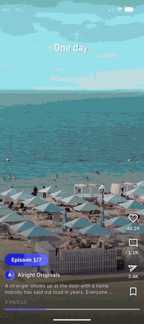 &nbsp;
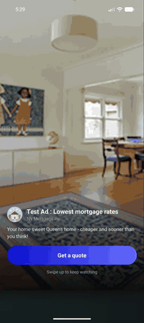

### [▶️ Watch the 36-second demo](docs/media/demo.mp4) &nbsp;·&nbsp; [📲 Download the APK](https://github.com/shivaAg04/short-drama/releases/latest)

### 🎥 Full walkthrough: every feature, timestamped

<a href="https://www.youtube.com/shorts/aFoWyebRYxM">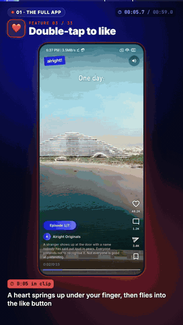</a>

**[▶️ Watch the 1:54 walkthrough on YouTube](https://www.youtube.com/shorts/aFoWyebRYxM)** &nbsp;·&nbsp; [or the MP4](docs/media/walkthrough.mp4)

The full app (33 features), ads that show instantly, and what happens when an ad fails.

</div>

---

## ✨ What it does

> Everything below was recorded on an Android emulator, straight from the app.

<table>
<tr>
<td align="center" width="33%">
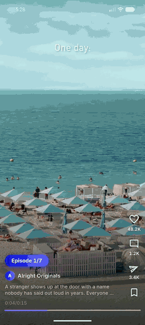<br>
<b>❤️ Double-tap to like</b><br>
<sub>The heart pops up under your finger on a spring, then flies into the like button.</sub>
</td>
<td align="center" width="33%">
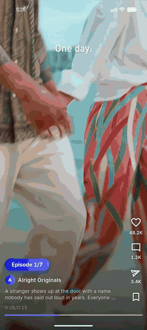<br>
<b>⏩ Scrub anywhere</b><br>
<sub>Drag across the screen: the custom-painted bar grows, and a frame preview + <code>00:05 / 00:15</code> follow your finger.</sub>
</td>
<td align="center" width="33%">
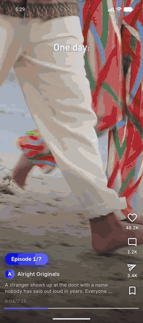<br>
<b>📺 Ad breaks that feel like episodes</b><br>
<sub>Google Ad Manager native ads after every 3 episodes, loaded before you get there.</sub>
</td>
</tr>
<tr>
<td align="center">
<br>
<b>🔒 The Episode 7 paywall</b><br>
<sub>Live blur, a card that bounces up, a glint every 3 s, and a feed that won't scroll past.</sub>
</td>
<td align="center">
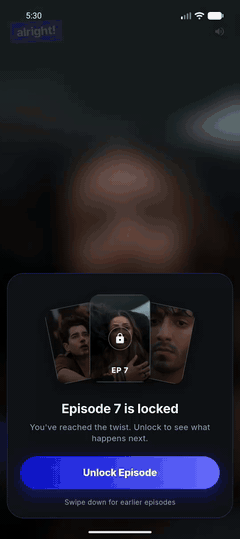<br>
<b>🔓 Unlock</b><br>
<sub>A simulated purchase: the card drops, the blur clears, the episode plays.</sub>
</td>
<td align="center">
<br>
<b>🚀 A splash that hides the wait</b><br>
<sub>"Stream. Binge. Drama." plays while Episode 1 buffers behind it.</sub>
</td>
</tr>
</table>

<details>
<summary>📸 <b>Screenshots</b></summary>
<br>
<p align="center">
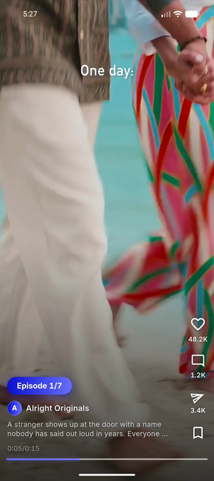
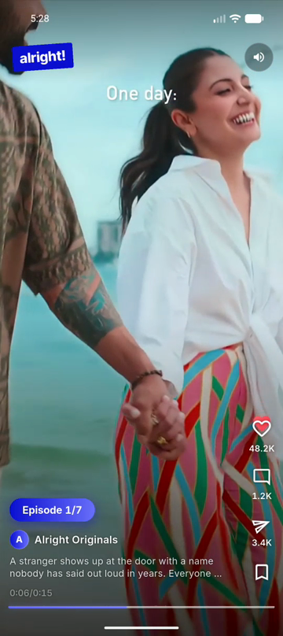
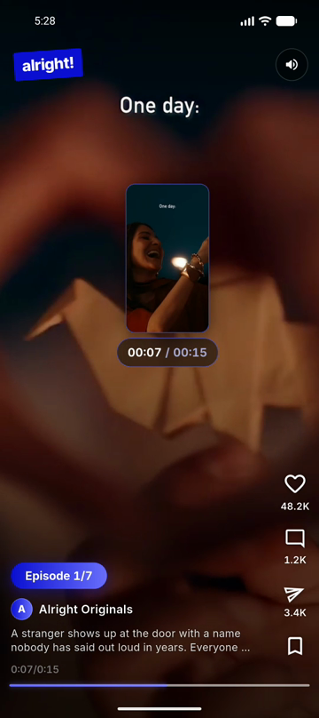
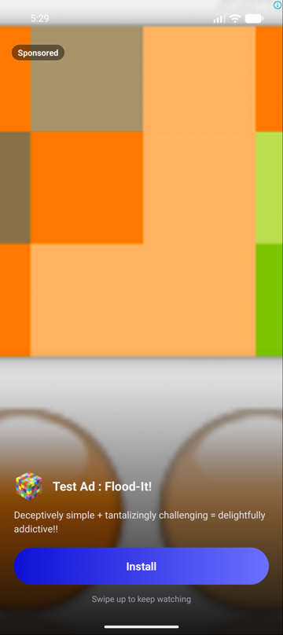
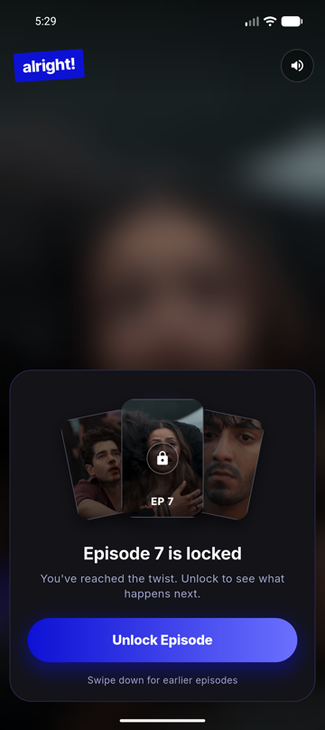
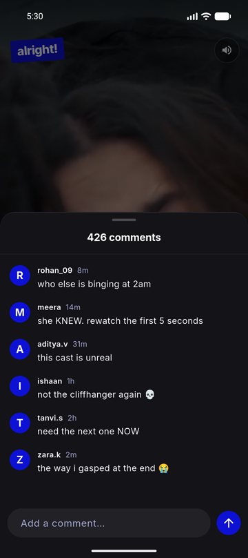
</p>
</details>

---

## 🏃 Run it

📲 **Just want to try it?** Grab the APK from the [latest release](https://github.com/shivaAg04/short-drama/releases/latest) and install it on an Android phone (allow installs from unknown sources).

🛠️ **From source:** built and tested with **Flutter 3.47.2 / Dart 3.13** (stable).

```sh
flutter pub get
flutter run                              # on a device or emulator
flutter test                             # whole suite, a few seconds
flutter analyze
dart run tool/spec_coverage.dart         # criteria → tests report
```

💥 Want to see failed ads leave the feed? Make every ad request come back empty:

```sh
flutter run --dart-define=AD_NO_FILL=true
```

- 🤖 **Android:** verified on the emulator (API 37).
- 🍎 **iOS:** the native ad layout (`AppDelegate.swift`), launch screen and icons are in place; building it needs a Mac with Xcode.
- 🧪 **Ads** use Google's sample Ad Manager units only. Debug builds show Google's "native ad validator" bubble; that is the SDK's overlay, not part of the app.

---

## ✅ The brief, and where each part lives

| | Brief | Criteria | Where |
|---|---|---|---|
| 📱 | Vertical feed of looping episodes, branded loading state, expandable description | `PLAY-1…13` | [`video_pool.dart`](lib/player/state/video_pool.dart), [`episode_page.dart`](lib/player/ui/episode_page.dart) |
| 📺 | Ads after every 3 episodes, preloaded, removed gracefully on failure | `FEED-1…9`, `AD-1…7` | [`feed_layout.dart`](lib/feed/domain/feed_layout.dart), [`feed_bloc.dart`](lib/feed/state/feed_bloc.dart), [`ads/`](lib/ads/) |
| ❤️ | Double-tap heart with spring physics | `LIKE-1…5` | [`heart_burst.dart`](lib/player/ui/heart_burst.dart) |
| ⏩ | Custom-painted scrub bar that expands, time preview following the finger | `SCRUB-1…11` | [`progress_bar.dart`](lib/player/ui/progress_bar.dart), [`episode_gestures.dart`](lib/player/ui/episode_gestures.dart) |
| 🔒 | E7 paywall: no playback, forward lock, live blur, overshoot card, shimmer every 3 s, unlock | `PAY-1…11` | [`feed_physics.dart`](lib/feed/ui/feed_physics.dart), [`paywall/`](lib/paywall/) |

## 🎁 Beyond the brief

- 🎨 **Alright! branding:** colours from alright.watch, the Inter font, the tilted "alright!" wordmark, launcher icons (Android adaptive and themed, iOS) and the app name.
- 🖼️ **Frame preview while scrubbing** (`SCRUB-8…10`): a thumbnail of the frame at that second, as on YouTube. Cloudinary renders any second of a video as an image from its URL; an episode's frames (one per second, ~13 KB each) are fetched on its first scrub and cached.
- 💬 **Engagement rail** (`RAIL-*`): like, a comments sheet you can post to, native share, save.
- 🚀 **Splash** (`SPLASH-*`): the feed is already playing by the time it's revealed.
- 🔇 **Top bar** (`TOP-*`): wordmark and mute; shows on touch, hides after 3 s.
- 📡 **Offline** (`OFF-*`): a video that can't load shows a "Couldn't load this episode" card instead of an endless loader, retries every 3 s, and starts on its own when the connection is back.
- ☀️ **Screen stays awake** while an episode plays, and only then.
- 📳 **Haptics** on like, scrub, hitting the lock and unlocking.

---

## 📐 Built spec-first

Every behaviour is a numbered acceptance criterion in [`specs/`](specs/), every criterion has a test tagged with its ID, and a small tool proves the two match.

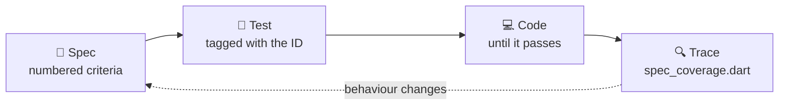

1. **Spec.** A file in `specs/` states the behaviour as numbered criteria (`PAY-4`, `OFF-2`, …), with the decisions taken and the alternatives rejected, before any code.
2. **Test.** Each criterion gets at least one test whose name starts with its ID: `testWidgets('[PAY-4] returning to the locked episode replays the entrance', …)`.
3. **Code** until those tests pass.
4. **Trace.** [`tool/spec_coverage.dart`](tool/spec_coverage.dart) lists every criterion and the tests covering it, flags criteria with no test, and fails on tests that cite a criterion that doesn't exist (`--strict` for CI).

```text
✓ PAY-3    test/feed/feed_flow_test.dart, test/feed/locked_page_physics_test.dart
✓ PAY-4    test/paywall/paywall_overlay_test.dart
m PAY-10   (manual, on device)
…
80/80 automated criteria covered by tests, 4 manual
```

When behaviour changed, the spec changed first. For example, an emulator run showed that a video failing to load left its page on the skeleton forever. That became [`specs/09-offline.md`](specs/09-offline.md), then tests, then the fix.

<details>
<summary>📚 <b>All nine specs</b></summary>

| Spec | Prefix | Area |
|---|---|---|
| [01-feed-composition](specs/01-feed-composition.md) | `FEED` | Page order, ad break removal |
| [02-playback](specs/02-playback.md) | `PLAY` | Feed, video pool, poster, caption, wakelock |
| [03-ads](specs/03-ads.md) | `AD` | GAM native ads |
| [04-micro-interactions](specs/04-micro-interactions.md) | `LIKE`, `SCRUB` | Double-tap like, scrubbing |
| [05-paywall](specs/05-paywall.md) | `PAY` | Episode 7 lock and unlock |
| [06-engagement](specs/06-engagement.md) | `RAIL` | Like, comment, share, save |
| [07-top-bar](specs/07-top-bar.md) | `TOP` | Wordmark and sound switch |
| [08-splash](specs/08-splash.md) | `SPLASH` | Launch, loading behind it |
| [09-offline](specs/09-offline.md) | `OFF` | Failed videos, retry, recovery |

</details>

---

## 🏗️ Architecture

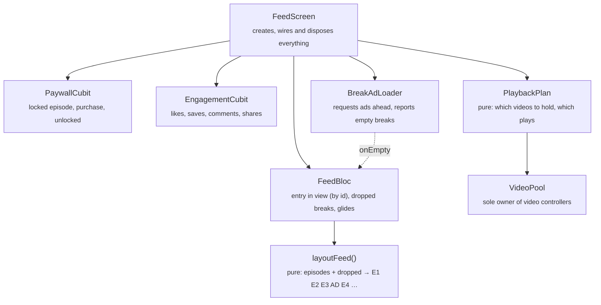

```text
lib/
  feed/        domain (Episode, FeedEntry, layoutFeed) · state (FeedBloc) · ui (screen, physics, top bar)
  player/      domain (PlaybackPlan) · state (VideoPool) · ui (episode page, gestures, heart, progress bar)
  paywall/     state (PaywallCubit) · ui (overlay, shimmer button)
  ads/         config, BreakAd interface + GAM implementation, loader, ad break page
  engagement/  counts, cubit, share service, rail, comments sheet
  splash/      launch splash
  shared/      wordmark, skeleton
  core/theme/  colours, theme
```

Widgets only read state. Every decision about what plays, what loads and what is removed is made in pure Dart or in a bloc, where it can be tested without a device.

<details>
<summary>🧠 <b>Decisions and trade-offs</b></summary>

#### 📜 Feed
- **Pages have ids, and focus is an id** (`episode:4`, `break:1`). The bloc remembers *which entry* is in view, not its index; the index is looked up in the layout. Pages are found by id too, so nothing rebuilds or restarts when the layout changes.
- **Dropping a failed ad break without a jump.** A break that isn't in view is dropped at once; if it was behind the user, the entry in view now sits one index lower and the screen moves the controller there before the next frame, so the content never moves. A break that *is* in view first glides the user on to the next episode, and is dropped once the feed is at rest. Nothing is dropped mid-gesture.
- **The paywall lock is a `ScrollPhysics`** that reads the locked page from a listenable. Past E7 a drag meets an exponential rubber band that can show at most 6% of the next page, and a release springs back. The physics do their own snapping, with PageView's turned off, so a fling can't get past.

#### 🎞️ Playback
- **At most three video controllers** (focused, next and previous). One per episode runs into memory and decoder limits on low-end Android; one in total shows a black frame on every swipe.
- **The focused video loads first**; the neighbours wait for it. A load that finishes after its episode has left the window is disposed straight away.
- **Pauses are held by reason** (`#background`, `#splash`), so coming back from the background during the splash can't start the video underneath it.
- **The progress bar is repainted, not rebuilt.** A `CustomPainter` listens to the controller and, between the player's position updates (roughly every 500 ms), interpolates frame by frame so the bar moves smoothly.
- **Retrying is the connectivity check.** Connectivity plugins report Wi-Fi with no internet as "online"; trying the video itself is the only honest test.

#### 📺 Ads
- **Full-screen native layouts in platform code** (Kotlin + XML, Swift), since GAM native ads have to be laid out natively. Google's sample units only.
- **`BreakAd` is an interface**, so the loader's deadline, failures and discarding are all tested with a fake. The GAM implementation is a thin wrapper.

</details>

---

## 🧪 Testing

| | |
|---|---|
| 🎯 Acceptance criteria | 84 in 9 specs: 80 automated (all covered) + 4 judged on a device |
| ✅ Tests | 171, all passing |
| 📊 Line coverage | 100% of `lib/` (1853 lines), except the `main.dart` bootstrap |
| 🧹 Lints | [`very_good_analysis`](https://pub.dev/packages/very_good_analysis), 0 issues |

🤖 [CI](.github/workflows/ci.yml) runs `flutter analyze`, the full suite with coverage, and `spec_coverage --strict` on every push, so these numbers can't quietly go stale.

<details>
<summary>🔬 <b>How it's tested</b></summary>

- **Unit:** layout, plan, physics, pool (with a fake clock for retries), cubits, ad loader.
- **Widget:** gestures (double-tap, scrub, vertical drags), paywall entrance and shimmer timing, splash, top bar, rail.
- **Flow** ([`feed_flow_test.dart`](test/feed/feed_flow_test.dart)): the real screen driven by flings. Swiping plays the next episode, a failed ad leaves the feed (even one behind you, without the page moving a pixel), the feed won't move past E7, unlocking plays it, backgrounding pauses.
- **Fakes only at the edges:** the video plugin ([`FakeVideoController`](test/helpers/fake_video_controller.dart)), the ad SDK and the share sheet. Everything between them is real.
- **The plugin adapters are contract-tested** at their boundary: the GAM adapter on the plugin's platform channel (test unit, our full-screen factory, muted, fill, no-fill, dispose), the share adapter through the share plugin's platform interface.
- **Coverage is 100% of lines**, every file in `lib/` counted, except [`main.dart`](lib/main.dart): plugin start-up and system UI setup that only run on a device (marked `coverage:ignore-file`, with the reason). Getting there turned up a real bug: the progress bar's clock restarted with its ticker, so after a long play a seek the player never confirmed was held far longer than its 800 ms limit.
- **Judged by hand:** four criteria, each marked *(manual)* in its spec: haptics on like (`LIKE-4`) and on the lock and unlock (`PAY-10`), which need a real phone; the launch-screen colour (`SPLASH-7`) and airplane-mode recovery (`OFF-6`), checked on the emulator.

</details>

---

## 🧩 Placeholders

- 🎥 **Videos:** seven demo clips, at most 20 s each, cut at scene changes (720×1280, H.264 with the index up front so playback starts while streaming), hosted on Cloudinary. Swapping content only changes [`episode_catalog.dart`](lib/feed/data/episode_catalog.dart); posters come from the same URLs.
- 💳 **The purchase is simulated:** "Unlock Episode" waits 700 ms, then unlocks for the session.
- 🔢 **Engagement counts are seeded** and live for the session only; there is no backend.

## 🛣️ Production next steps

- ⚡ **Prefetch only the start of long episodes.** With full-length episodes I'd prefetch only the first ~1 MB of the next 2 episodes through a local caching proxy (Range requests), so the start is instant without downloading whole files nobody may watch. With ~15 s clips this adds little: the next episode is already buffered by the 3-controller window.
- 💰 **Real purchases:** store billing (Play Billing / StoreKit) behind `PaywallCubit`, with entitlements checked on a server.
- ☁️ **Backend for engagement:** likes, saves and comments synced and persisted.
- 📶 **Adaptive streaming (HLS)** for long episodes on weak networks.
- 📈 **Analytics:** watch time, swipe-away points, paywall conversion, ad fill rate.
